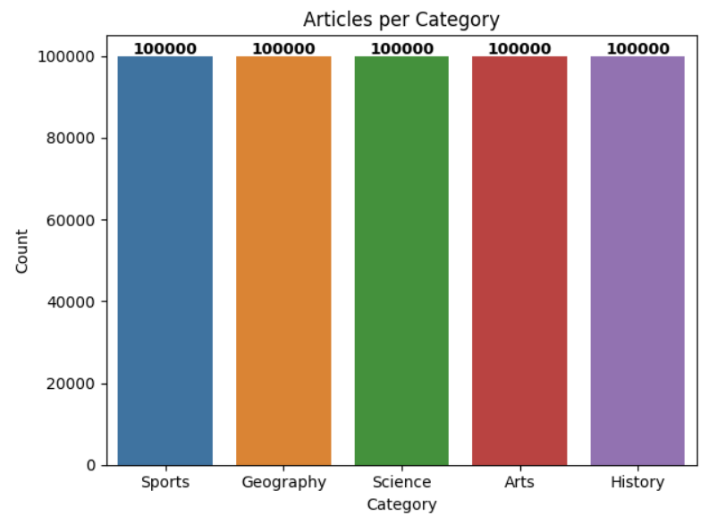
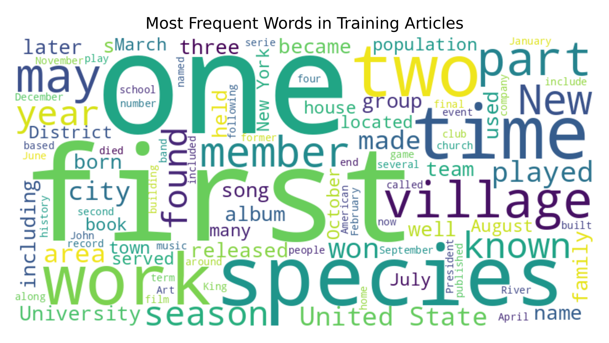
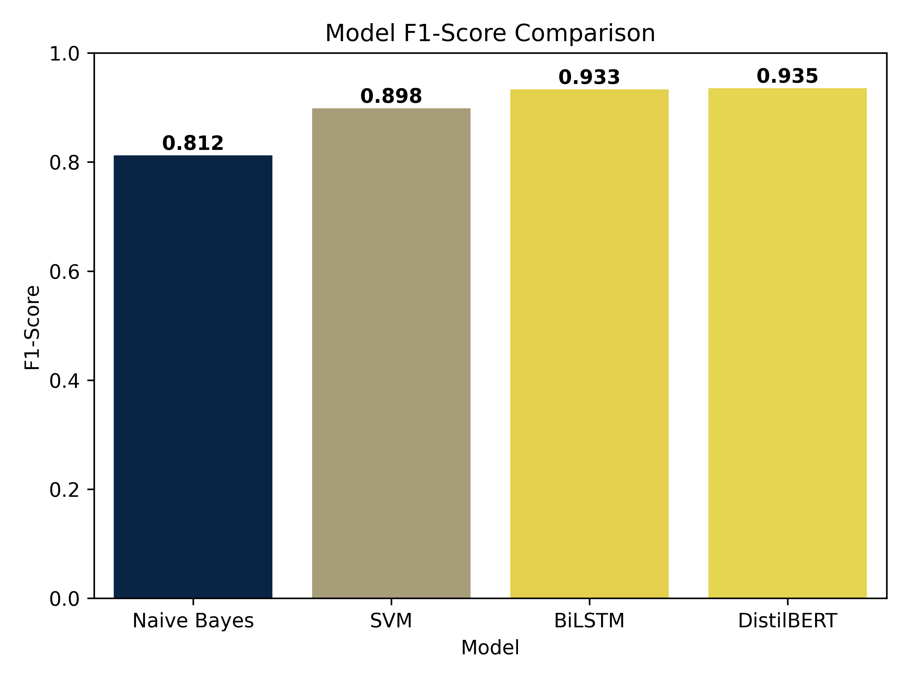
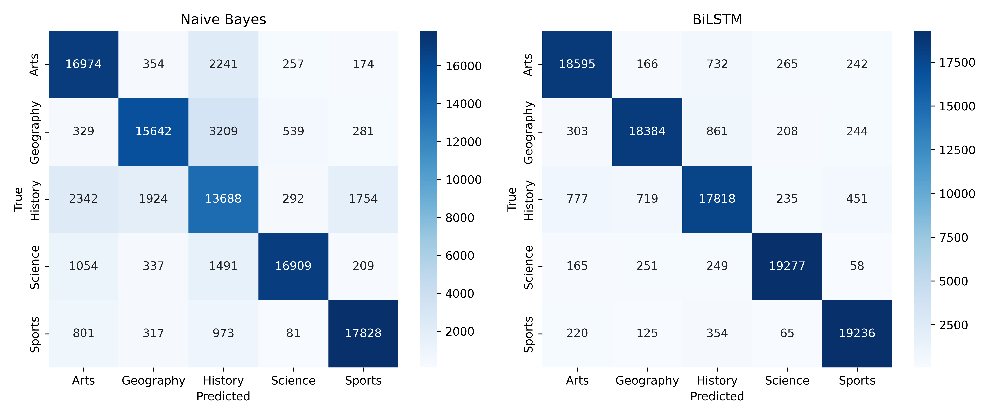

# Wikipedia Article Categorisation

This project implements and compares four text classification models on Wikipedia articles using traditional machine learning and deep learning approaches. Four classifiers are evaluated on a balanced 500K article dataset across five categories: Science, History, Sports, Arts, and Geography. The research systematically tests traditional algorithms including Naive Bayes and Support Vector Machines alongside modern neural network architectures, with BiLSTM and DistilBERT, to determine the most effective approach for article categorization tasks. DistilBERT achieves highest accuracy at 93.56% while maintaining practical performance with reasonable compute requirements.

## Models Compared

| Model | Type | Accuracy | Precision | Recall | F1-Score |
|-------|------|----------|-----------|--------|----------|
| Naive Bayes | Traditional ML | 81.04% | 81.62% | 81.04% | 81.22% |
| SVM | Traditional ML | 89.87% | 89.88% | 89.87% | 89.83% |
| BiLSTM | Deep Learning | 93.31% | 93.31% | 93.31% | 93.31% |
| DistilBERT | Deep Learning | 93.56% | 93.56% | 93.56% | 93.54% |

## Data Source

The dataset comes from the Wikipedia Structured Contents Kaggle dataset (https://www.kaggle.com/datasets/wikimedia-foundation/wikipedia-structured-contents). English Wikipedia articles were processed and balanced across five categories: Science, History, Sports, Arts, and Geography. The dataset contains 500K articles with 400K for training and 100K for testing, with all categories represented equally at 100K each.

## Key Findings

Traditional machine learning models showed minimal improvement from hyperparameter tuning. Naive Bayes achieved 81.04% accuracy while SVM improved to 89.87% accuracy with the same hyperparameter optimization. Deep learning models performed significantly better, with BiLSTM reaching 93.31% accuracy and DistilBERT achieving 93.56% accuracy. The tradeoff between accuracy and training time varies by use case, with DistilBERT requiring more computational resources but providing the best classification performance.

## Images

  

    
  

  

    
  

  

    
  

  

    
  

